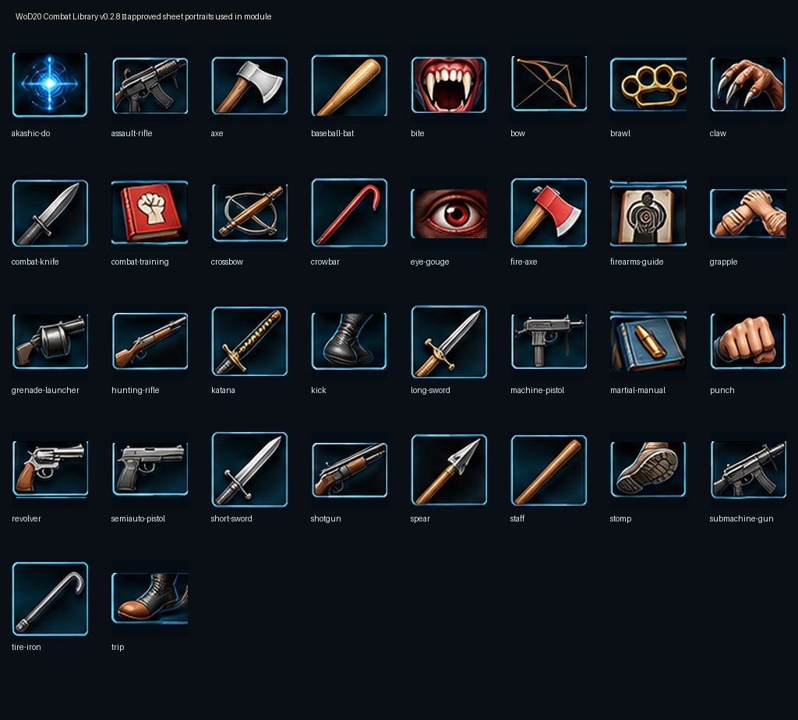

# WoD20 Combat Library

Browse the **WoD20 Combat Library** compendium, drag a **copy** of a weapon or maneuver to a character you control, then use native WoD20 Items where the system supports rolls. Players can read the source compendium, but cannot edit its protected masters.

## What's in the library

- **Weapons** — native melee, ranged and thrown weapons; Punch, Kick, Bite and Claw are native natural weapons.
- **Dirty Fighting** — Head Butt, Curbstomp, Low Blow and other maneuvers, including rules-reference-only Features when native rolling isn't appropriate.
- **Martial Arts** — blocks, kicks, locks, counters and throws.
- **Akashic Do** — specialized techniques and training reference, without invented rules automation.
- **Reference material** — weapons, concealment, attack and reload notes.

The catalog contains **142 existing Items**. v0.2.8 applies 34 full-color concepts from the approved equipment/combat reference sheet to **63 matching catalog entries**; the corrected **Throw** and **Joint Lock** portraits and the earlier illustrated action set remain. Other entries retain v0.2.7 art. The mockup also shows armor, shields, ammunition and martial-style examples that **are not Items in this module**; they have not been invented or imported.

## Requirements

Foundry VTT 13–14 with the `worldofdarkness` WoD20 system. Exact real-world Foundry 14 compatibility and the live World Item icon update still need confirmation.

## Install and use

1. Open **Foundry Setup → Add-on Modules → Install Module**, provide the [manifest](https://raw.githubusercontent.com/rebsiot/wod-combat-library/main/module.json), or choose **Update All** if already installed.
2. Enable **WoD20 Combat Library** in **Game Settings → Manage Modules** for the chosen world.
3. After backing up the world, enter as GM, hard refresh **Ctrl+Shift+R**, and review/approve the Combat Library content/icon update prompt if presented.
4. Open **Compendium Packs → WoD20 Combat Library** and drag **Hatchet** or **Punch** onto an editable PC Actor sheet.
5. As a player, verify the item can be copied but the source compendium master cannot be edited.

## World Items, custom images, and rollback

Compendium Items and World Items are distinct documents. The GM-approved preview identifies eligible existing World Items, already-current icons, and protected custom images. For eligible Items, the module changes **only `img`**, backing up old image paths and preserving Item IDs, types, flags, stats, names, folders and text. **No mass import** takes place. Actor-owned Items are not migrated; copies still pointing to older icon paths retain their previous art unless the underlying image file itself changed.

Back up both the installed module and **world data** before approving a migration. To roll back code, reinstall v0.2.7. If the update changed world Item image paths, restore the matching world snapshot; restoring module code alone does not undo persistent icon-path edits. If the GM update preview unexpectedly shows zero eligible entries, do not delete or mass-reimport your Items.

## Limitations and testing

- Automated/mock validation: 142 catalog entries, SVG assets, native Item types, upgrades, permissions, preservation of IDs and custom artwork, and full ZIP structural integrity.
- **Live Foundry 14 workflow not yet verified** for this release: module installation, GM preview, World Item icon refresh, player drag/copy, and protected master permissions.
- Reference-only maneuver `Feature` Items do not gain unsupported native weapon rolls from new art.
- Some catalog entries share a suitable reference image; the approved mockup is an art direction, not a promise of unique Item art for every catalog entry.

## Support and credits

[Issues](https://github.com/rebsiot/wod-combat-library/issues) · [Releases](https://github.com/rebsiot/wod-combat-library/releases) · [Changelog](CHANGELOG.md) · [Icon credits](THIRD_PARTY_ICONS.md)

The v0.2.8 portraits come from the user-approved AI-generated Combat Library reference sheet. Remaining Game-Icons.net illustrations use their recorded artist attributions and respective CC BY 3.0/CC0 terms. This is an unofficial World of Darkness fan tool; permission to redistribute substantial rules text or list the package officially must be reviewed separately. No TC Modern creator content, credentials or player data are included.