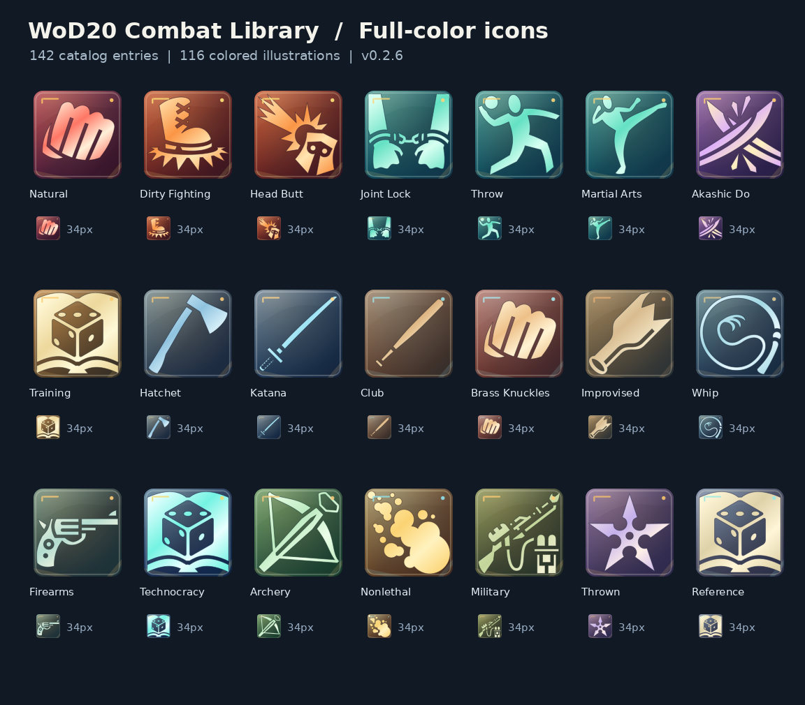

# WoD20 Combat Library

Browse the **WoD20 Combat Library** compendium, drag a **copy** of a weapon or maneuver onto a character you control, and use native WoD20 Items where the rules support a roll. The shared compendium masters are readable to players but protected from player edits.

## What's inside

- **Weapons:** native melee, ranged, natural and thrown weapons where the WoD20 sheet supports those mechanics. Basic Punch, Kick, Bite and Claw are native natural weapons.
- **Dirty Fighting:** practical attacks such as Curbstomp, Head Butt and Pistol Whip; unusual maneuvers may remain reference-only Features.
- **Martial Arts:** striking, blocking, locks and throws, including techniques that require Storyteller adjudication.
- **Akashic Do:** specialized techniques and training references. The module does not invent rules automation for extraordinary effects.
- **Reference guides:** brief equipment, concealment and action notes.

The 142 catalog entries use 116 distinct bundled Game-Icons silhouettes in 19 category color palettes. Icons work offline and are designed to remain recognizable at Foundry sidebar sizes.

## Requirements

- Foundry VTT 13–14 (module compatibility metadata; **live Foundry 14 regression is pending**).
- World of Darkness 20th system (`worldofdarkness`, previously documented around 7.3.x). Verify the installed system version before reporting a compatibility issue.

## Install and get started

1. In Foundry **Setup → Add-on Modules → Install Module**, use the manifest URL below, or update an existing install using **Update All**.
2. Enable **WoD20 Combat Library** in your world's **Game Settings → Manage Modules**.
3. Press **Ctrl+Shift+R** in your Foundry browser. As GM, review and approve **Create/Update WoD20 Combat Library** if offered, after making a world backup.
4. Open **Compendium Packs → WoD20 Combat Library**, find **Hatchet** or **Punch**, and drag a copy onto an editable character sheet.
5. Check **Combat → Melee Weapons / Natural Weapons**. Test as a player: the player should be able to view and copy Items, not edit the source compendium.

**Manifest:** `https://raw.githubusercontent.com/rebsiot/wod-combat-library/main/module.json`

**Release ZIP:** https://github.com/rebsiot/wod-combat-library/releases/latest

## GM: refresh old World Item icons

Compendium entries and copied World Items are separate Foundry documents. A **GM-approved** update previews how many World Items match this library, how many are already current, and how many custom images are excluded. It updates only `img` on qualifying World Items, saves prior image paths in a hidden world setting, and preserves IDs, types, folders, names, descriptions, statistics, flags and customizations. It is **not** a mass overwrite and does not import a second set of World Items.

**New in v0.2.6:** Existing Items already referencing this module's SVG filenames receive the new colors automatically when files are refreshed. Those same paths may be used by character-owned copies: their displayed artwork changes without editing the Actor document. The GM update pass is for older placeholder-image World Items that still need a managed path assigned.

Back up the Foundry **world data**, including the compendium, before approving an in-world icon refresh. Restore the matching world snapshot if you need to undo an icon migration; reinstalling old module code alone does not restore modified world documents.

## Known limitations and status

- **Automated/mock tested:** all catalog mappings, icon assets, installed-package integrity, Player/GM permission model, compendium upgrades and guarded World Item icon updates.
- **Not confirmed live for v0.2.6:** GM-approved World Item matching and player drag/drop in a real Foundry 14 world. A green release workflow is not a live session.
- Many special combat maneuvers are intentionally read-only/reference `Feature` Items, not fabricated weapon rolls. The module is **not** a combat automation engine.
- Icon artwork cannot replace a custom image. Items whose image path does not match known defaults or this module's managed art are left untouched.
- No automatic synchronization of weapon statistics or descriptions from masters to character-owned copies.

## Support, licensing and credits

[GitHub issues](https://github.com/rebsiot/wod-combat-library/issues) · [Releases](https://github.com/rebsiot/wod-combat-library/releases) · [Changelog](CHANGELOG.md) · [Third-party icon credits](THIRD_PARTY_ICONS.md)

Illustrations adapted from the user-supplied **Game-Icons.net** collection. Per-icon artists are credited in `THIRD_PARTY_ICONS.md`; artwork is generally CC BY 3.0 with noted CC0 exceptions. Color palettes, gradients, SVG presentation and highlights have been modified. Do not treat this icon license as an unrestricted license for the separate module code or World of Darkness rules text.

Combat references are summaries of user-supplied *Mage: The Ascension 20th Anniversary Edition* excerpts. This is unofficial fan material. Permissions for broader redistribution of copyrighted rules text and any software licensing need maintainer review before an official public listing. No licensed TC Modern artwork, user worlds or credentials are distributed.